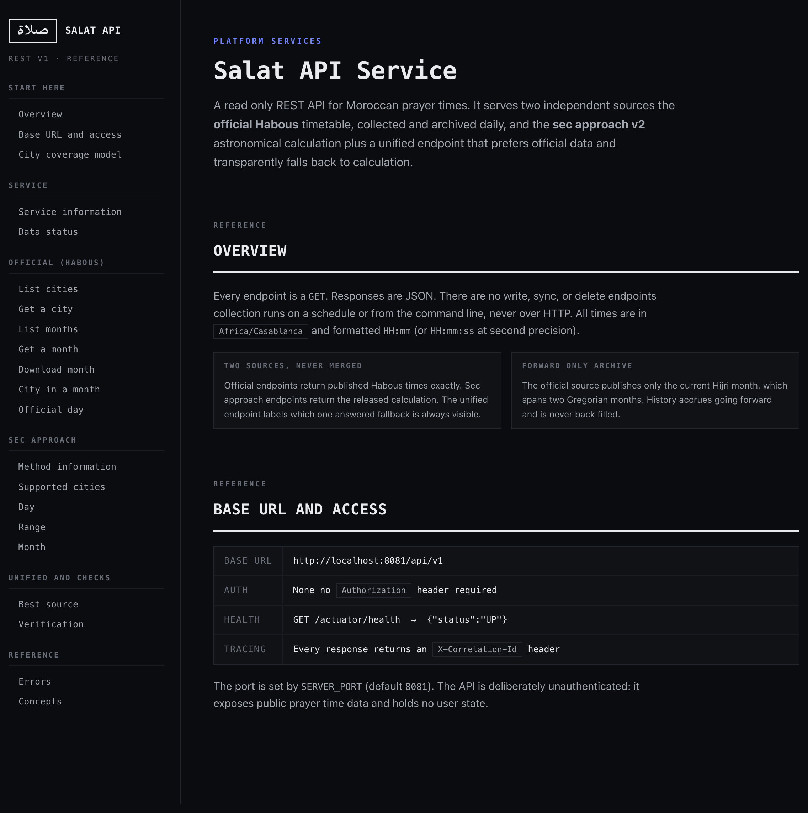
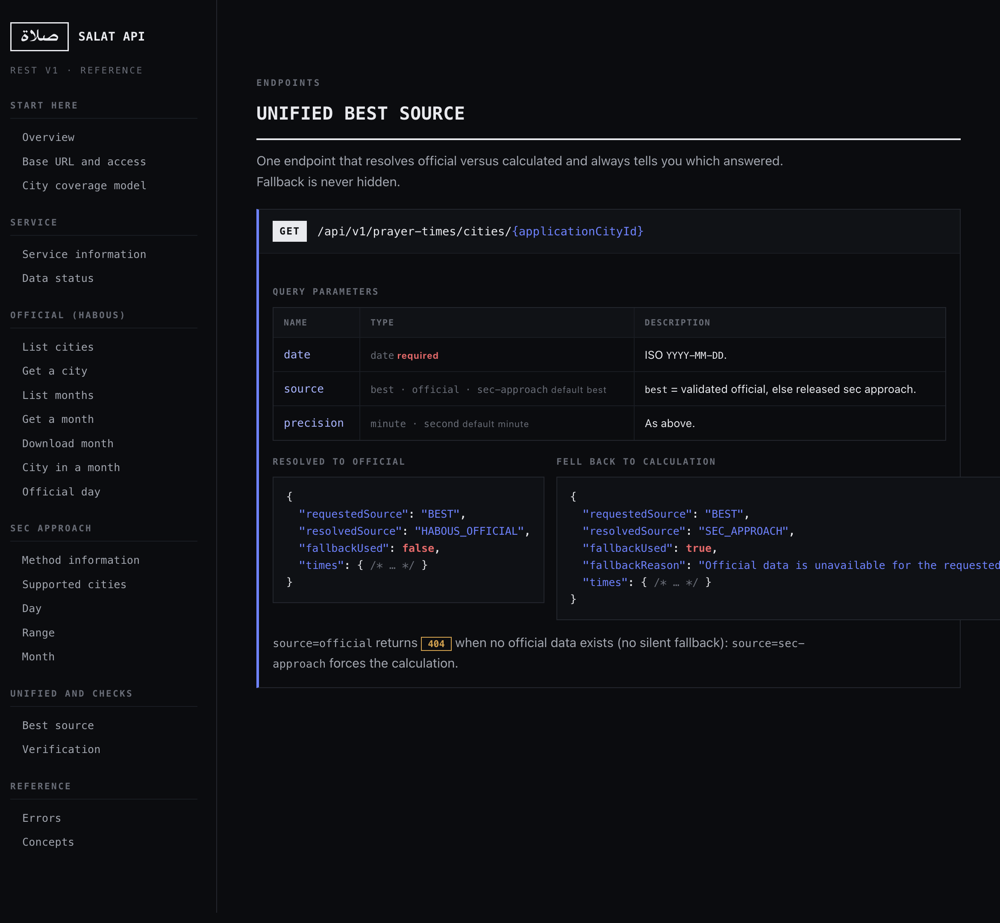
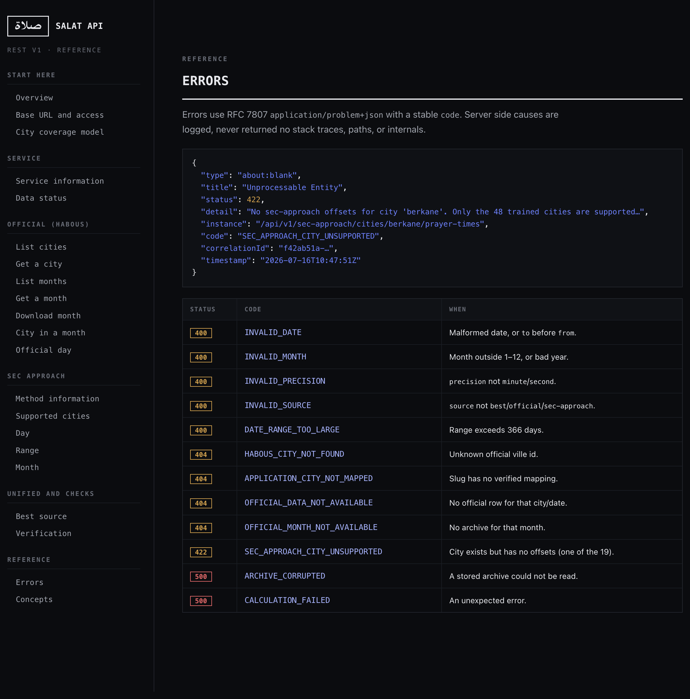

# Salat API Service Guide du projet

*Une référence unique pour les développeurs et les responsables : ce que fait le
service, comment les horaires de prière sont calculés, comment obtenir des données
officielles fiables auprès du Ministère des Habous, et comment utiliser chaque point
d'accès (endpoint).*

**Auteur :** Mohamed Khassal GitHub [@Cyonecoder](https://github.com/Cyonecoder)
**Dépôt :** [Cyonecoder/PrayerTime-calculator](https://github.com/Cyonecoder/PrayerTime-calculator) · module `platform-services/salat-api-service`
**Version :** REST v1 · paramètres sec-approach `morocco-habous-secaproach-v2`
**Fuseau horaire :** tous les horaires sont en `Africa/Casablanca`
**Documentation API en direct :** lancez le service et ouvrez `http://localhost:8081/docs`

---

## 1. Résumé pour la direction

Le Salat API Service est une petite application Spring Boot autonome qui expose les
**horaires de prière marocains** via une API REST en lecture seule. Elle combine deux
sources indépendantes :

1. **Données officielles Habous :** l'horaire publié par le Ministère marocain des
   Habous, collecté et archivé automatiquement chaque jour. C'est la source de vérité.
2. **Sec-approach v2 :** un calcul astronomique, validé par rapport aux données
   officielles, capable de produire des horaires pour n'importe quelle date.

Un unique **point d'accès unifié** répond avec les données officielles lorsqu'elles
existent, et bascule de manière transparente vers le calcul dans le cas contraire, en
indiquant toujours quelle source a répondu.

Propriétés clés, en un coup d'oeil :

| Propriété | Valeur |
|---|---|
| Sources | Habous officiel + sec-approach v2 (jamais fusionnées) |
| Villes prises en charge (calcul) | 48 |
| Villes officielles (catalogue) | 191 |
| Stockage | Fichiers JSON locaux : **aucune base de données** |
| Authentification | **Aucune** : données publiques d'horaires de prière |
| Déploiement | Un processus, un port HTTP, un répertoire de données |
| Précision du calcul | ~97% exact à la minute par rapport à l'officiel, sur une fenêtre estivale validée (voir section 2) |

---

## 2. Comment les horaires sont calculés (sec-approach v2)

### 2.1 Le modèle

Un horaire de prière publié est produit en trois étapes :

1. **Temps astronomique brut.** Une formule globale figée et reconstruite calcule le
   temps brut de l'événement (en secondes du jour) à partir de la position du soleil :
   date julienne, déclinaison solaire, équation du temps, et l'angle horaire pour
   l'altitude de chaque prière. C'est un calcul astronomique standard, identique pour
   chaque ville.
2. **Décalage (offset) par ville et par prière.** Un **décalage constant unique, en
   secondes**, est ajouté au temps brut. Chacune des 48 villes prises en charge possède
   ses six décalages (un par prière). Ces décalages absorbent les petites différences
   systématiques entre l'astronomie pure et ce que Habous publie réellement.
3. **Arrondi vers le bas à la minute.**

La formule, exactement :

```
publishedMinute = floor( (rawSeconds + offsetSeconds[city][prayer]) / 60 )
```

Les six prières sont `fajr`, `sunrise`, `dhuhr`, `asr`, `maghrib`, `isha`.

> **Pourquoi un décalage, et non une correction quotidienne ?** Le décalage est un
> *paramètre* de calcul fixe (un biais inférieur à la minute et une limite d'arrondi),
> et non une consultation des données officielles. Il n'y a **aucune table quotidienne,
> mensuelle ou saisonnière**, aucun repli sur la ville la plus proche, et aucun repli
> par défaut sur Casablanca. Une ville a des décalages (elle fait partie des 48) ou
> elle est refusée : le service ne devine jamais.

### 2.2 Modes de précision

- **minute** (par défaut) : l'horaire publié, `HH:mm`.
- **second** : `rawSeconds + offset` avant l'arrondi, `HH:mm:ss`. Diagnostic : utile
  pour comprendre l'arrondi.

### 2.3 Précision et sa portée honnête

Les décalages ont été entraînés et validés sur la fenêtre **2026-06-17 au 2026-07-16**
(un mois hégirien estival, hors Ramadan). Sur cette fenêtre, le calcul concorde avec
l'horaire officiel **exactement à la minute pour environ 97%** des valeurs
ville-prière, et à une minute près pour la quasi-totalité.

Chaque chiffre de précision rapporté par le service porte cette clause de non-garantie,
mot pour mot :

> *"Validated on the 2026-06-17 through 2026-07-16 summer window. Not an annual accuracy claim."*

C'est important pour les responsables : le calcul est une excellente **estimation**,
vérifiée en continu par rapport à la réalité (voir section 3.5), mais les données officielles
Habous restent la source faisant autorité et doivent être préférées dès qu'elles sont
disponibles.

### 2.4 Garanties de stabilité

- Les **14 villes d'origine** sont identiques octet pour octet au premier jeu de
  paramètres publié : la v2 n'a fait qu'*étendre* la couverture à 48.
- Les décalages ne sont **jamais ré-entraînés à l'exécution**. La vérification
  quotidienne mesure la précision : elle ne modifie jamais les paramètres.

---

## 3. Données officielles fiables de Habous

### 3.1 La source

Les horaires proviennent du point d'accès officiel :

```
https://www.habous.gov.ma/prieres/horaire_hijri_2.php?ville={id}
```

Il prend exactement un paramètre, `ville`, et renvoie **uniquement le mois hégirien en
cours**. Il n'existe aucun sélecteur de mois ou d'année, donc **l'historique ne peut
pas être reconstitué a posteriori** : l'archive se constitue vers l'avant à partir du
jour où le service commence la collecte.

### 3.2 L'atteindre en toute sécurité (la note TLS)

Le serveur Habous envoie une **chaîne de certificats TLS incomplète** (seulement sa
feuille, en omettant l'intermédiaire Sectigo). Les navigateurs et `curl` récupèrent
automatiquement l'intermédiaire manquant : la JVM ne le fait pas, donc un client Java
naïf échoue avec `PKIX path building failed`.

Le service corrige cela **sans affaiblir la sécurité** : il embarque l'unique
intermédiaire Sectigo public et l'ajoute comme ancre de confiance supplémentaire *par
dessus* les valeurs par défaut de la plateforme (un gestionnaire de confiance
composite). La vérification du nom d'hôte et la validation du certificat restent
pleinement actives : un certificat sans rapport ou falsifié est toujours rejeté. Voir
[`HABOUS_SOURCE.md`](HABOUS_SOURCE.md) pour la provenance du certificat et la procédure
de rotation.

### 3.3 Le pipeline de collecte quotidien

Une fois par jour (par défaut 03:15 Africa/Casablanca), pour **chaque** ville
officielle :

1. **Récupérer** l'horaire courant (de manière respectueuse : une requête à la fois,
   500 ms d'intervalle, nouvelles tentatives limitées avec backoff, uniquement sur les
   échecs transitoires).
2. **Valider la ville :** la page marque la ville servie : une incohérence est rejetée,
   et non stockée sous le mauvais identifiant.
3. **Analyser (parser)** le tableau hégirien à neuf colonnes.
4. **Valider** les lignes : dates contiguës, les six colonnes de prière présentes.
5. **Stocker la source brute** de façon immuable, avec son empreinte SHA-256. Une page
   modifiée devient une *révision* : une page valide n'est **jamais écrasée**.

Un échec pour une ville n'affecte jamais les autres, et n'efface jamais les données
déjà collectées.

### 3.4 De l'hégirien au grégorien

Un mois hégirien chevauche deux mois grégoriens (par ex. 17 juin au 16 juillet). Le
parseur lit les deux noms de mois grégoriens dans l'en-tête de la page, résout chaque
ligne en une date non ambiguë, et la classe dans la bonne archive mensuelle
**grégorienne**. Ainsi une page récupérée alimente **deux** archives, et un mois
grégorien n'est `COMPLETE` qu'une fois les *deux* pages hégiriennes qui le chevauchent
collectées.

Valeurs de statut d'archive :

| Statut | Signification |
|---|---|
| `EMPTY` | Aucune ligne validée pour l'instant. |
| `PARTIAL` | Des lignes existent : le mois se constitue encore (l'état intermédiaire normal). |
| `COMPLETE` | Chaque ville active possède chaque jour du mois. |
| `DEGRADED` | Contient des données, mais une ville a échoué définitivement ou le catalogue a changé en cours de collecte. |

### 3.5 La vérification, le mécanisme de confiance

Chaque jour, le service compare le calcul sec-approach aux données officielles pour les
villes qui possèdent les deux, et stocke un rapport. Les métriques utilisent
`secApproachMinute − officialMinute` et comprennent le nombre et le taux de
correspondances exactes, le nombre et le taux à une minute près, la différence absolue
moyenne et maximale, ventilés **par ville** et **par prière**, ainsi que les empreintes
des sources officielles.

C'est ce qui permet à un responsable de *faire confiance au calcul* : sa concordance
avec la réalité est mesurée en continu et publiée, et non affirmée une seule fois.

---

## 4. Obtenir des « informations fiables, appuyées par notre calcul »

La façon recommandée de consommer l'API est le **point d'accès unifié « meilleure
source »** :

```
GET /api/v1/prayer-times/cities/{applicationCityId}?date=YYYY-MM-DD&source=best
```

`source=best` se résout ainsi :

```
données officielles validées  ->  sinon, sec-approach publié
```

La réponse indique **toujours** ce qui s'est passé, de sorte qu'un repli n'est jamais
masqué :

```json
{
  "applicationCityId": "rabat",
  "date": "2026-07-15",
  "requestedSource": "BEST",
  "resolvedSource": "SEC_APPROACH",
  "fallbackUsed": true,
  "fallbackReason": "Official data is unavailable for the requested date",
  "times": { "fajr": "04:39", "sunrise": "06:24", "dhuhr": "13:38",
             "asr": "17:19", "maghrib": "20:43", "isha": "22:14" }
}
```

- Lorsque des données officielles existent pour cette ville et cette date,
  `resolvedSource` vaut `HABOUS_OFFICIAL` et `fallbackUsed` vaut `false`.
- `source=official` renvoie `404` (aucun repli silencieux) lorsque les données
  officielles manquent.
- `source=sec-approach` force le calcul dans tous les cas.

Vous obtenez ainsi des données de qualité officielle lorsqu'elles existent, et une
estimation calculée et validée sinon, toujours clairement étiquetée.

---

## 5. Modèle de couverture des villes (à ne pas confondre)

Quatre groupes imbriqués. Seules 48 villes peuvent être calculées : collecter des
données officielles pour une ville ne la rend **pas** calculable.

| Groupe | Nombre | Signification | Identifiant |
|---|---|---|---|
| Villes officielles | **191** | Dans l'annuaire Habous : éligibles à la collecte. | `habousCityId` |
| Villes du registre | **67** | Villes applicatives avec slug, coordonnées, alias. | `applicationCityId` |
| Correspondances vérifiées | **60** | Villes du registre liées à une ville officielle confirmée. | les deux |
| Sec-approach | **48** | Possèdent des décalages publiés : les seules villes calculables. | `applicationCityId` |

`48 ⊆ 60 ⊆ 67`, et les 60 cibles de villes ⊆ les 191. Demander sec-approach pour l'une
des 19 autres villes du registre renvoie `422 SEC_APPROACH_CITY_UNSUPPORTED` : jamais
une supposition.

---

## 6. Référence de l'API

URL de base `http://localhost:8081/api/v1`. Chaque point d'accès est en `GET`, renvoie
du JSON, et ne nécessite **aucun en-tête d'autorisation**. Il n'existe **aucun point
d'accès d'écriture, de synchronisation ou de suppression** : la collecte se fait via la
planification ou en ligne de commande (section 7).

### 6.1 Tous les points d'accès

| Méthode | Chemin | Rôle |
|---|---|---|
| GET | `/info` | Compteurs de couverture, version des paramètres, fraîcheur des données. |
| GET | `/data-status` | Emplacement des données, état du planificateur, statut par mois, dernière vérification. |
| GET | `/habous/cities` | Catalogue officiel : filtres `mapped`, `secApproachSupported`, `available`. |
| GET | `/habous/cities/{habousCityId}` | Une ville officielle. |
| GET | `/habous/cities/by-application-id/{slug}` | Ville officielle par slug applicatif. |
| GET | `/habous/months` | Résumés des archives mensuelles stockées. |
| GET | `/habous/months/{year}/{month}` | Archive mensuelle complète (`?includeUnavailable=true`). |
| GET | `/habous/months/{year}/{month}/file` | Télécharger l'archive en JSON. |
| GET | `/habous/months/{year}/{month}/cities/{habousCityId}` | Une ville dans un mois. |
| GET | `/habous/months/{year}/{month}/application-cities/{slug}` | Idem, par slug. |
| GET | `/habous/cities/{habousCityId}/prayer-times?date=` | Un jour officiel. |
| GET | `/habous/application-cities/{slug}/prayer-times?date=` | Un jour officiel, par slug. |
| GET | `/sec-approach/info` | Métadonnées de la méthode, fenêtre de validation, clause de non-garantie. |
| GET | `/sec-approach/cities` | Les 48 villes prises en charge. |
| GET | `/sec-approach/cities/{slug}/prayer-times?date=&precision=` | Jour calculé. |
| GET | `/sec-approach/cities/{slug}/prayer-times/range?from=&to=&precision=` | Plage calculée (≤ 366 jours). |
| GET | `/sec-approach/cities/{slug}/prayer-times/month?year=&month=&precision=` | Mois calculé. |
| GET | `/prayer-times/cities/{slug}?date=&source=&precision=` | **Unifié, meilleure source.** |
| GET | `/verification/latest` | Dernier rapport de vérification quotidien. |
| GET | `/verification/dates/{date}` | Rapport pour une date. |
| GET | `/verification/dates/{date}/cities/{slug}` | Comparaison d'une ville pour une date. |
| GET | `/verification/months/{year}/{month}` | Tous les rapports d'un mois. |

Valeurs des paramètres de requête : `precision` vaut `minute` (par défaut) ou `second`.
`source` vaut `best` (par défaut), `official`, ou `sec-approach`.

### 6.2 Exemples courants

```bash
# Santé
curl http://localhost:8081/actuator/health

# Vue d'ensemble du service
curl http://localhost:8081/api/v1/info

# Les 48 villes calculables
curl http://localhost:8081/api/v1/sec-approach/cities

# Jour calculé (n'importe quelle date)
curl "http://localhost:8081/api/v1/sec-approach/cities/rabat/prayer-times?date=2026-07-15"

# Recommandé : meilleure source disponible, avec repli transparent
curl "http://localhost:8081/api/v1/prayer-times/cities/rabat?date=2026-07-15&source=best"

# Mois officiel, et téléchargement
curl http://localhost:8081/api/v1/habous/months/2026/7
curl http://localhost:8081/api/v1/habous/months/2026/7/file -o habous-2026-07.json
```

### 6.3 Erreurs

Les erreurs utilisent RFC-7807 `application/problem+json` avec un `code` stable. Les
causes côté serveur sont journalisées, jamais renvoyées (ni traces de pile, ni chemins,
ni détails internes).

| Statut | Code | Quand |
|---|---|---|
| 400 | `INVALID_DATE` | Date mal formée, ou `to` avant `from`. |
| 400 | `INVALID_MONTH` | Mois hors 1 à 12, ou année invalide. |
| 400 | `INVALID_PRECISION` | `precision` autre que `minute`/`second`. |
| 400 | `INVALID_SOURCE` | `source` autre que `best`/`official`/`sec-approach`. |
| 400 | `DATE_RANGE_TOO_LARGE` | Plage supérieure à 366 jours. |
| 404 | `HABOUS_CITY_NOT_FOUND` | Identifiant de ville officielle inconnu. |
| 404 | `APPLICATION_CITY_NOT_MAPPED` | Le slug n'a aucune correspondance vérifiée. |
| 404 | `OFFICIAL_DATA_NOT_AVAILABLE` | Aucune ligne officielle pour cette ville/date. |
| 404 | `OFFICIAL_MONTH_NOT_AVAILABLE` | Aucune archive pour ce mois. |
| 422 | `SEC_APPROACH_CITY_UNSUPPORTED` | La ville existe mais n'a aucun décalage (l'une des 19). |
| 500 | `ARCHIVE_CORRUPTED` | Une archive stockée n'a pas pu être lue. |
| 500 | `CALCULATION_FAILED` | Une erreur inattendue. |

Chaque réponse porte aussi un en-tête `X-Correlation-Id` pour la traçabilité.

### 6.4 La référence interactive sur /docs

Le service embarque sa propre **référence d'API navigable**. Lancez l'application et
ouvrez `http://localhost:8081/docs` : elle est servie directement par le processus en
cours d'exécution (aucune étape de build, aucune ressource externe, aucun déploiement),
elle correspond donc toujours à la version que vous exécutez. Chaque point d'accès y est
documenté avec ses paramètres, un exemple de requête et un exemple de réponse.



Le point d'accès unifié **meilleure source** est le plus utilisé : il renvoie les
données officielles Habous lorsqu'elles existent et bascule de façon transparente vers
le calcul, en indiquant toujours quelle source a répondu.



Les erreurs sont documentées au même endroit, en miroir du tableau de codes stables
ci-dessus.



---

## 7. Exécution et exploitation du service

### 7.1 Compiler et lancer

```bash
cd platform-services/salat-api-service
./gradlew clean test          # exécuter la suite de tests (ne touche jamais au réseau)
./gradlew bootRun             # démarrer l'API sur http://localhost:8081
# ou
./gradlew build && java -jar build/libs/salat-api-service.jar
```

Le dossier est autonome : il peut être copié hors du dépôt et compilé seul.

### 7.2 Configuration (variables d'environnement)

| Variable | Défaut | Rôle |
|---|---|---|
| `SERVER_PORT` | `8081` | Port HTTP. |
| `SALAT_DATA_DIRECTORY` | `./data` | Où les archives, rapports et sources brutes sont lus/écrits. |
| `HABOUS_SYNC_ENABLED` | `true` | Activer le planificateur de collecte quotidien. |
| `HABOUS_SYNC_CRON` | `0 15 3 * * *` | Planning de collecte (Africa/Casablanca). |
| `HABOUS_REQUEST_DELAY` | `500ms` | Délai entre les requêtes des villes. |
| `HABOUS_MAXIMUM_ATTEMPTS` | `3` | Tentatives par ville, la première comprise. |
| `SALAT_MAXIMUM_RANGE_DAYS` | `366` | Plafond du point d'accès de plage sec-approach. |

### 7.3 Alimenter les données (aucun chemin d'écriture HTTP)

La collecte s'exécute selon la planification, ou à la demande en ligne de commande :

```bash
# Collecter maintenant (toutes les villes officielles) dans un répertoire de données explicite
java -jar salat-api-service.jar --salat.job=sync-now \
  --spring.main.web-application-type=none --salat.data-directory=./data

# Réassembler un mois grégorien à partir des instantanés stockés, sans réseau
java -jar salat-api-service.jar --salat.job=rebuild-month \
  --salat.job.period=2026-07 --spring.main.web-application-type=none

# Réassembler chaque mois à partir des instantanés stockés
java -jar salat-api-service.jar --salat.job=rebuild-archives \
  --spring.main.web-application-type=none

# Vérifier une date par rapport à son archive
java -jar salat-api-service.jar --salat.job=verify-date \
  --salat.job.date=2026-07-15 --spring.main.web-application-type=none

# Développer avec le planificateur désactivé
HABOUS_SYNC_ENABLED=false ./gradlew bootRun
```

### 7.4 Le piège d'exploitation le plus courant

Si une requête officielle renvoie `404 OFFICIAL_DATA_NOT_AVAILABLE` de façon
inattendue, le serveur lit presque certainement un **répertoire de données qui ne
contient rien pour cette date**. Vérifiez où il lit et ce qu'il contient :

```bash
curl http://localhost:8081/api/v1/data-status   # regardez dataDirectory + monthlyArchiveStatuses
```

Le service journalise aussi le répertoire de données absolu résolu au démarrage.
Passez toujours le **même** `--salat.data-directory` à la fois au job de
synchronisation et au serveur en cours d'exécution (un chemin absolu est le plus sûr).
Comme l'historique ne peut pas être reconstitué, ne supprimez pas le répertoire de
données : copiez-le si vous devez le déplacer.

### 7.5 Rotation du certificat

Si Habous change son émetteur TLS, la collecte échoue avec `TLS_HANDSHAKE_FAILED` et le
résumé de l'exécution le rend évident. Inspectez la chaîne en direct, examinez le
nouvel intermédiaire, et remplacez le certificat embarqué : ne désactivez jamais la
vérification. Procédure complète dans [`HABOUS_SOURCE.md`](HABOUS_SOURCE.md).

---

## 8. Architecture du projet et packages

### 8.1 Flux de données à l'exécution

Tout se passe dans un seul processus. Les données circulent de la source officielle,
via un stockage immuable, vers les archives grégoriennes que lisent à la fois l'API
officielle et la vérification quotidienne. Le moteur de calcul alimente la vérification
et l'API unifiée.

```html
<div class="arch">
  <div class="arch-layer"><div class="arch-tag ext">Externe</div><div class="arch-nodes">
    <div class="arch-node"><b>habous.gov.ma</b><span>Horaire officiel, un mois hégirien, chaîne TLS incomplète</span></div>
  </div></div>
  <div class="arch-flow">collecte quotidienne, par ville, client TLS augmenté (section 8.4)</div>
  <div class="arch-layer"><div class="arch-tag">Ingestion</div><div class="arch-nodes">
    <div class="arch-node"><b>habous.client</b><span>Récupération, tentatives, confiance TLS</span></div>
    <div class="arch-node"><b>habous.parser</b><span>Tableau hégirien 9 colonnes</span></div>
    <div class="arch-node"><b>habous.validation</b><span>Contiguïté, 6 colonnes, ville concordante</span></div>
  </div></div>
  <div class="arch-flow">stockage immuable</div>
  <div class="arch-layer"><div class="arch-tag store">Stockage</div><div class="arch-nodes">
    <div class="arch-node"><b>archive.repository (brut)</b><span>Instantanés de source, SHA-256, révisions, jamais écrasés</span></div>
  </div></div>
  <div class="arch-flow">assembler</div>
  <div class="arch-layer"><div class="arch-tag store">Assemblage</div><div class="arch-nodes">
    <div class="arch-node"><b>archive.service</b><span>Découpe une page hégirienne en deux archives mensuelles grégoriennes</span></div>
  </div></div>
  <div class="arch-flow">lecture</div>
  <div class="arch-split">
    <div class="arch-layer"><div class="arch-tag svc">Diffusion</div><div class="arch-nodes">
      <div class="arch-node hl"><b>api, officiel</b><span>Archives et jours Habous</span></div>
    </div></div>
    <div class="arch-layer"><div class="arch-tag compute">Calcul</div><div class="arch-nodes">
      <div class="arch-node"><b>verification</b><span>Officiel vs calcul, quotidien</span></div>
      <div class="arch-node"><b>secapproach</b><span>Moteur v2 : astronomie + décalages</span></div>
    </div></div>
  </div>
  <div class="arch-flow">unifier</div>
  <div class="arch-layer"><div class="arch-tag svc">Diffusion</div><div class="arch-nodes">
    <div class="arch-node hl"><b>api, sec-approach + « meilleure source » unifiée</b><span>Officiel si disponible, sinon calcul, source toujours indiquée</span></div>
  </div></div>
</div>
```

### 8.2 Packages Java

Package racine `io.github.cyonecoder.salatapi`. Les responsabilités sont séparées par
package, jamais par module déployable.

| Package | Responsabilité |
|---|---|
| `SalatApiApplication` | Point d'entrée Spring Boot : un processus, un port HTTP. |
| `common` | Types de valeur partagés : `Prayer`, `PrayerTimes`, heure civile, empreinte SHA-256. |
| `city` | Les quatre groupes de villes : registre (67), annuaire officiel (191), correspondances vérifiées (60), résolution du niveau de prise en charge. |
| `secapproach` | Le calcul v2 : astronomie (`calculation`), paramètres publiés (`configuration`), modèle, service, exception. |
| `habous` | Accès à la source officielle : client HTTP + confiance TLS, parseurs HTML, validation de page/horaire, services de catalogue et de collecte. |
| `archive` | Archives mensuelles grégoriennes : modèles, dépôts fichiers (brut + mensuel), l'assembleur et le service mensuel, écriture JSON atomique. |
| `verification` | Comparaison quotidienne sec-approach vs officiel, métriques et rapports. |
| `scheduling` | Le job de synchronisation quotidien `@Scheduled`, le verrou d'exécution processus/fichier, et le rapport de synchronisation. |
| `application` | Services de requête en lecture qui alimentent l'API (horaires, archives mensuelles, statut des données). |
| `api` | Contrôleurs REST, DTO de requête/réponse, gestion des erreurs `ProblemDetail`, filtre d'identifiant de corrélation. |
| `jobs` | Jobs ponctuels en ligne de commande (`sync-now`, `rebuild-archives`, `rebuild-month`, `verify-date`). |
| `config` | `@ConfigurationProperties` typées, le bean `HttpClient` TLS, l'activation du planificateur, les contrôles d'intégrité au démarrage, et la route `/docs`. |

### 8.3 Contrat de confiance TLS

Le site officiel présente une **chaîne de certificats incomplète** : il envoie son
certificat feuille mais omet l'intermédiaire Sectigo qui le relie à une racine publique.
Les navigateurs et `curl` récupèrent l'intermédiaire manquant à la volée : la JVM ne le
fait pas, si bien qu'un client Java naïf échoue au handshake avec
`PKIX path building failed`. Le service comble cette lacune en *augmentant* la confiance,
jamais en la désactivant.

```html
<div class="tls">
  <div class="tls-step"><b>JDK HttpClient</b><span>salat-api-service, bean habousHttpClient</span></div>
  <div class="tls-join">&#8594;</div>
  <div class="tls-step bad"><b>habous.gov.ma</b><span>N'envoie que la feuille, omet l'intermédiaire Sectigo</span></div>
  <div class="tls-join">&#8594;</div>
  <div class="tls-step"><b>Gestionnaire de confiance composite</b><span>CA de la plateforme d'abord, puis l'intermédiaire Sectigo embarqué</span></div>
  <div class="tls-join">&#8594;</div>
  <div class="tls-step good"><b>Validé</b><span>Nom d'hôte, expiration et signature : tous les contrôles passent</span></div>
</div>
```

Le contrat, énoncé clairement : ce que le service impose toujours, ce qu'il ajoute, et
ce qu'il ne fait jamais :

```html
<div class="contract">
  <div class="keep"><h5>Toujours imposé</h5><ul><li>Vérification du nom d'hôte</li><li>Expiration du certificat</li><li>Signature et validation de chaîne</li></ul></div>
  <div class="add"><h5>Augmenté (ajouté)</h5><ul><li>Un intermédiaire Sectigo embarqué</li><li>Superposé aux CA de la plateforme</li><li>Ne rattrape que le maillon manquant</li></ul></div>
  <div class="never"><h5>Jamais</h5><ul><li>Aucun gestionnaire tout-confiance</li><li>Aucun contournement du nom d'hôte</li><li>Aucun changement global de confiance JVM</li><li>Aucun certificat téléchargé à l'exécution</li></ul></div>
</div>
```

L'intermédiaire est **embarqué dans le dépôt**, non téléchargé à l'exécution : la
décision de confiance est donc auditable et reproductible hors ligne. Il est limité au
seul client Habous et ne modifie pas le magasin de confiance global de la JVM. Si Habous
effectue une rotation de son certificat, le fichier embarqué est l'unique point de
rotation : voir [`HABOUS_SOURCE.md`](HABOUS_SOURCE.md) pour la provenance du certificat
et la procédure de rotation.

### 8.4 Garanties

- **Une seule application Spring Boot**, séparée par package comme ci-dessus, jamais
  découpée en modules.
- **Aucune base de données, aucune authentification, aucun JWT/Spring Security, aucune
  exigence Docker, aucun broker de messages.** L'état réside dans des fichiers JSON
  locaux sous un seul répertoire.
- **Surface HTTP en lecture seule :** 22 routes `GET`, zéro point d'accès
  d'écriture/suppression.
- **Sources brutes immuables** avec empreintes et révisions : les archives
  s'accumulent et n'écrasent jamais de données valides après une synchronisation en
  échec.
- **Historique vers l'avant uniquement** (la source n'a pas de paramètre de mois).
- **Le démarrage est hors ligne :** il valide les ressources embarquées et crée les
  répertoires de données, mais ne contacte jamais Habous, de sorte que les points
  d'accès sec-approach et de lecture démarrent même lorsque le site officiel est
  indisponible.
- Adossé à une suite de tests automatisés incluant un contrôle de parité qui reproduit
  exactement le calcul d'origine (les 48 villes, les deux précisions, à travers une
  transition de fuseau horaire et un jour bissextile) et des garde-fous pour chaque
  règle « à ne pas faire ».

---

## 9. Glossaire

| Terme | Signification |
|---|---|
| **Habous** | Le Ministère marocain des Habous et des Affaires islamiques : éditeur de l'horaire officiel. |
| **Ville** | Une ville officielle Habous : identifiée par un `habousCityId` numérique. |
| **Ville applicative** | Une ville du registre du service, identifiée par un slug (`applicationCityId`). |
| **Sec-approach** | Le calcul publié : astronomie reconstruite + décalages constants en secondes par ville. |
| **Décalage (offset)** | Une valeur fixe en secondes, par ville et par prière, ajoutée avant l'arrondi à la minute. |
| **Page hégirienne** | Un mois du calendrier lunaire tel que publié par Habous : chevauche deux mois grégoriens. |
| **Archive** | Un fichier JSON mensuel grégorien contenant les jours collectés de chaque ville officielle. |
| **Vérification** | La comparaison quotidienne mesurée du calcul par rapport aux données officielles. |

---

## 10. Documentation complémentaire

- **Référence API navigable en direct :** `http://localhost:8081/docs` (servie par
  l'application).
- **Détails TLS/certificat et rotation :** [`HABOUS_SOURCE.md`](HABOUS_SOURCE.md).
- **Ce guide (source) :** `docs/PROJECT_GUIDE.fr.md`. Étendez-le, puis régénérez le PDF
  avec `scripts/build-guide-pdf.sh docs/PROJECT_GUIDE.fr.md`.
