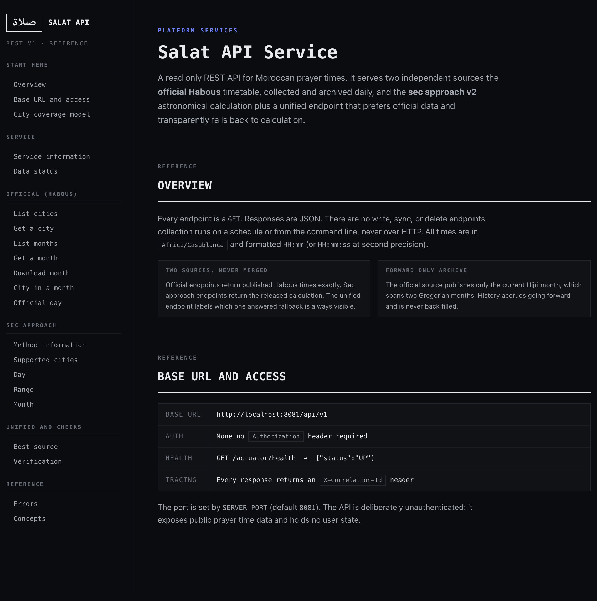
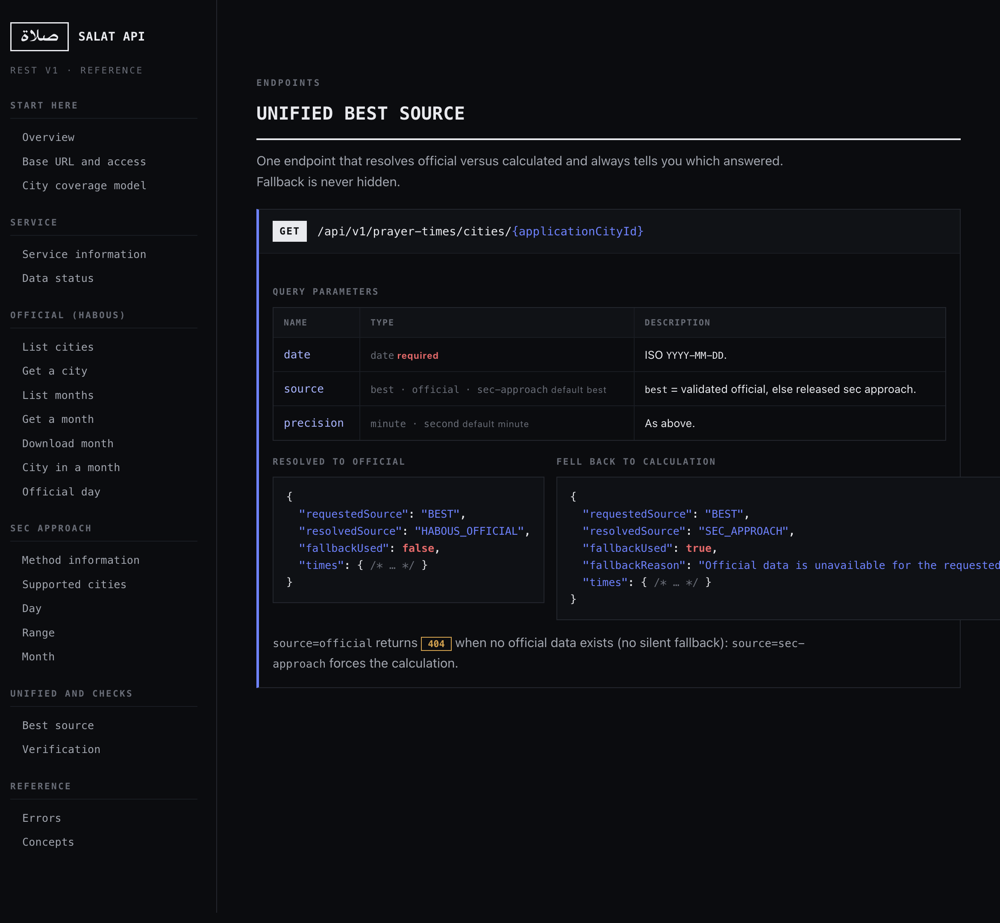
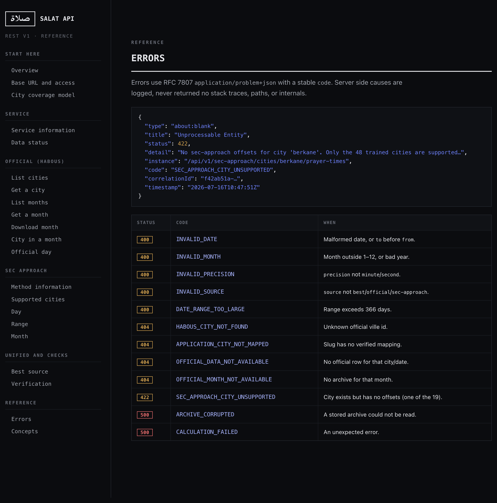

# Salat API Service Project Guide

*A single reference for developers and managers: what the service does, how prayer
times are calculated, how trusted official data is obtained from the Ministry of
Habous, and how to use every endpoint.*

**Author:** Mohamed Khassal GitHub [@Cyonecoder](https://github.com/Cyonecoder)
**Repository:** [Cyonecoder/PrayerTime-calculator](https://github.com/Cyonecoder/PrayerTime-calculator) · module `platform-services/salat-api-service`
**Version:** REST v1 · sec-approach parameters `morocco-habous-secaproach-v2`
**Timezone:** all times are `Africa/Casablanca`
**Live API docs:** run the service and open `http://localhost:8081/docs`

---

## 1. Executive summary

The Salat API Service is a small, self-contained Spring Boot application that serves
**Moroccan prayer times** over a read-only REST API. It combines two independent
sources:

1. **Official Habous data** the prayer timetable published by the Moroccan Ministry
   of Habous, collected and archived automatically every day. This is the ground
   truth.
2. **Sec-approach v2** an astronomical calculation, validated against the official
   data, that can produce times for any date.

A single **unified endpoint** answers with official data when it exists and
transparently falls back to the calculation when it does not always telling the
caller which source answered.

Key properties, at a glance:

| Property | Value |
|---|---|
| Sources | Official Habous + sec-approach v2 (never merged) |
| Supported cities (calculation) | 48 |
| Official cities (catalogue) | 191 |
| Storage | Local JSON files **no database** |
| Authentication | **None** public prayer-time data |
| Deployment | One process, one HTTP port, one data directory |
| Accuracy of the calculation | ~97% exact-to-the-minute vs official, on a validated summer window (see section 2) |

---

## 2. How prayer times are calculated (sec-approach v2)

### 2.1 The model

A published prayer time is produced in three steps:

1. **Raw astronomical time.** A frozen, reconstructed global formula computes the raw
   event time (in seconds of the day) from the sun's position Julian date, solar
   declination, equation of time, and the hour angle for each prayer's altitude. This
   is standard astronomical calculation, identical for every city.
2. **Per-city, per-prayer offset.** A single **constant offset, in seconds**, is added
   to the raw time. Each of the 48 supported cities has its own six offsets (one per
   prayer). These offsets absorb the small, systematic differences between pure
   astronomy and what Habous actually publishes.
3. **Floor to the minute.**

The formula, exactly:

```
publishedMinute = floor( (rawSeconds + offsetSeconds[city][prayer]) / 60 )
```

The six prayers are `fajr`, `sunrise`, `dhuhr`, `asr`, `maghrib`, `isha`.

> **Why an offset, not a per-day correction?** The offset is a fixed calculation
> *parameter* a sub-minute bias and rounding boundary not a lookup of official
> data. There is **no per-day, monthly, or seasonal table**, no nearest-city fallback,
> and no default to Casablanca. A city either has offsets (it is one of the 48) or it
> is refused the service never guesses.

### 2.2 Precision modes

- **minute** (default) the published time, `HH:mm`.
- **second** `rawSeconds + offset` before the floor, `HH:mm:ss`. Diagnostic: useful
  for understanding rounding.

### 2.3 Accuracy and its honest scope

The offsets were trained and validated on the window **2026-06-17 to 2026-07-16** (a
summer, non-Ramadan Hijri month). On that window the calculation agrees with the
official timetable **exactly to the minute for roughly 97%** of city-prayer values,
and within one minute for essentially all of them.

Every accuracy figure the service reports carries this disclaimer verbatim:

> *"Validated on the 2026-06-17 through 2026-07-16 summer window. Not an annual accuracy claim."*

This matters for managers: the calculation is an excellent **estimate**, continuously
checked against reality (see section 3.5), but the official Habous data remains the
authoritative source and should be preferred whenever available.

### 2.4 Stability guarantees

- The **14 original cities** are byte-identical to the first released parameter set:
  v2 only *extended* coverage to 48.
- Offsets are **never retrained at runtime**. Daily verification measures accuracy: it
  never changes the parameters.

---

## 3. Trusted official data from Habous

### 3.1 The source

Times come from the official endpoint:

```
https://www.habous.gov.ma/prieres/horaire_hijri_2.php?ville={id}
```

It takes exactly one parameter, `ville`, and returns **the current Hijri month only**.
There is no month or year selector, so **history cannot be back-filled** the archive
accrues going forward from the day the service starts collecting.

### 3.2 Reaching it securely (the TLS note)

The Habous server sends an **incomplete TLS certificate chain** (its leaf only,
omitting the Sectigo intermediate). Browsers and `curl` recover the missing
intermediate automatically: the JDK does not, so a naïve Java client fails with
`PKIX path building failed`.

The service fixes this **without weakening security**: it bundles the one public
Sectigo intermediate and adds it as an extra trust anchor *on top of* the platform
defaults (a composite trust manager). Hostname verification and certificate validation
stay fully enabled: an unrelated or forged certificate is still rejected. See
[`HABOUS_SOURCE.md`](HABOUS_SOURCE.md) for certificate provenance and the rotation
procedure.

### 3.3 The daily collection pipeline

Once a day (default 03:15 Africa/Casablanca), for **every** official city:

1. **Fetch** the current timetable (respectful: one request at a time, 500 ms apart,
   bounded retries with backoff on transient failures only).
2. **Validate the city** the page marks the served city: a mismatch is rejected, not
   stored under the wrong id.
3. **Parse** the nine-column Hijri table.
4. **Validate** the rows contiguous dates, all six prayer columns present.
5. **Store the raw source** immutably, with its SHA-256 checksum. A changed page
   becomes a *revision*: a valid page is **never overwritten**.

A failure for one city never affects the others, and never erases previously collected
data.

### 3.4 Hijri to Gregorian

A Hijri month straddles two Gregorian months (e.g. 17 Jun – 16 Jul). The parser reads
the two Gregorian month names from the page header, resolves each row to an
unambiguous date, and files it into the correct **Gregorian** monthly archive. So one
fetched page feeds **two** archives, and a Gregorian month is only `COMPLETE` once
*both* overlapping Hijri pages have been collected.

Archive status values:

| Status | Meaning |
|---|---|
| `EMPTY` | No validated rows yet. |
| `PARTIAL` | Rows exist: the month is still accruing (the normal in-between state). |
| `COMPLETE` | Every enabled city has every day of the month. |
| `DEGRADED` | Has data, but a city failed permanently or the catalogue changed mid-collection. |

### 3.5 Verification the trust mechanism

Every day, the service compares the sec-approach calculation against the official data
for the cities that have both, and stores a report. Metrics use
`secApproachMinute − officialMinute` and include exact-match count and ratio,
within-one-minute count and ratio, mean and maximum absolute difference, broken down
**by city** and **by prayer**, plus the official source checksums.

This is what lets a manager *trust the calculation*: its agreement with reality is
measured continuously and published, not asserted once.

---

## 4. Getting "trusted info, backed by our calculation"

The recommended way to consume the API is the **unified best-source endpoint**:

```
GET /api/v1/prayer-times/cities/{applicationCityId}?date=YYYY-MM-DD&source=best
```

`source=best` resolves as:

```
validated official data  →  otherwise, released sec-approach
```

The response **always** states what happened, so a fallback is never hidden:

```json
{
  "applicationCityId": "rabat",
  "date": "2026-07-15",
  "requestedSource": "BEST",
  "resolvedSource": "SEC_APPROACH",
  "fallbackUsed": true,
  "fallbackReason": "Official data is unavailable for the requested date",
  "times": { "fajr": "04:39", "sunrise": "06:24", "dhuhr": "13:38",
             "asr": "17:19", "maghrib": "20:43", "isha": "22:14" }
}
```

- When official data exists for that city and date, `resolvedSource` is
  `HABOUS_OFFICIAL` and `fallbackUsed` is `false`.
- `source=official` returns `404` (no silent fallback) when official data is missing.
- `source=sec-approach` forces the calculation regardless.

This gives you official-grade data when it exists and a validated calculated estimate
otherwise always clearly labelled.

---

## 5. City coverage model (do not confuse these)

Four nested groups. Only 48 cities can be calculated: collecting official data for a
city does **not** make it calculable.

| Group | Count | Meaning | Identifier |
|---|---|---|---|
| Official villes | **191** | In the Habous directory: eligible for collection. | `habousCityId` |
| Registry cities | **67** | Application cities with slug, coordinates, aliases. | `applicationCityId` |
| Verified mappings | **60** | Registry cities linked to a confirmed official ville. | both |
| Sec-approach | **48** | Have released offsets: the only calculable cities. | `applicationCityId` |

`48 ⊆ 60 ⊆ 67`, and the 60 ville targets ⊆ the 191. Asking sec-approach for any of the
other 19 registry cities returns `422 SEC_APPROACH_CITY_UNSUPPORTED` never a guess.

---

## 6. API reference

Base URL `http://localhost:8081/api/v1`. Every endpoint is `GET`, returns JSON, and
requires **no authorization header**. There are **no write, sync, or delete
endpoints** collection runs on a schedule or from the CLI (section 7).

### 6.1 All endpoints

| Method | Path | Purpose |
|---|---|---|
| GET | `/info` | Coverage counts, parameter version, data freshness. |
| GET | `/data-status` | Where data lives, scheduler state, per-month status, latest verification. |
| GET | `/habous/cities` | Official catalogue: filters `mapped`, `secApproachSupported`, `available`. |
| GET | `/habous/cities/{habousCityId}` | One official city. |
| GET | `/habous/cities/by-application-id/{slug}` | Official city by application slug. |
| GET | `/habous/months` | Summaries of stored monthly archives. |
| GET | `/habous/months/{year}/{month}` | Full monthly archive (`?includeUnavailable=true`). |
| GET | `/habous/months/{year}/{month}/file` | Download the archive as JSON. |
| GET | `/habous/months/{year}/{month}/cities/{habousCityId}` | One city in one month. |
| GET | `/habous/months/{year}/{month}/application-cities/{slug}` | Same, by slug. |
| GET | `/habous/cities/{habousCityId}/prayer-times?date=` | One official day. |
| GET | `/habous/application-cities/{slug}/prayer-times?date=` | One official day, by slug. |
| GET | `/sec-approach/info` | Method metadata, validation window, disclaimer. |
| GET | `/sec-approach/cities` | The 48 supported cities. |
| GET | `/sec-approach/cities/{slug}/prayer-times?date=&precision=` | Calculated day. |
| GET | `/sec-approach/cities/{slug}/prayer-times/range?from=&to=&precision=` | Calculated range (≤ 366 days). |
| GET | `/sec-approach/cities/{slug}/prayer-times/month?year=&month=&precision=` | Calculated month. |
| GET | `/prayer-times/cities/{slug}?date=&source=&precision=` | **Unified best source.** |
| GET | `/verification/latest` | Most recent daily verification report. |
| GET | `/verification/dates/{date}` | Report for a date. |
| GET | `/verification/dates/{date}/cities/{slug}` | One city's comparison for a date. |
| GET | `/verification/months/{year}/{month}` | Every report in a month. |

Query parameter values: `precision` is `minute` (default) or `second`: `source` is
`best` (default), `official`, or `sec-approach`.

### 6.2 Common examples

```bash
# Health
curl http://localhost:8081/actuator/health

# Service overview
curl http://localhost:8081/api/v1/info

# The 48 calculable cities
curl http://localhost:8081/api/v1/sec-approach/cities

# Calculated day (any date)
curl "http://localhost:8081/api/v1/sec-approach/cities/rabat/prayer-times?date=2026-07-15"

# Recommended: best available source, with transparent fallback
curl "http://localhost:8081/api/v1/prayer-times/cities/rabat?date=2026-07-15&source=best"

# Official month, and download it
curl http://localhost:8081/api/v1/habous/months/2026/7
curl http://localhost:8081/api/v1/habous/months/2026/7/file -o habous-2026-07.json
```

### 6.3 Errors

Errors are RFC-7807 `application/problem+json` with a stable `code`. Server-side causes
are logged, never returned (no stack traces, paths, or internals).

| Status | Code | When |
|---|---|---|
| 400 | `INVALID_DATE` | Malformed date, or `to` before `from`. |
| 400 | `INVALID_MONTH` | Month outside 1–12, or bad year. |
| 400 | `INVALID_PRECISION` | `precision` not `minute`/`second`. |
| 400 | `INVALID_SOURCE` | `source` not `best`/`official`/`sec-approach`. |
| 400 | `DATE_RANGE_TOO_LARGE` | Range exceeds 366 days. |
| 404 | `HABOUS_CITY_NOT_FOUND` | Unknown official ville id. |
| 404 | `APPLICATION_CITY_NOT_MAPPED` | Slug has no verified mapping. |
| 404 | `OFFICIAL_DATA_NOT_AVAILABLE` | No official row for that city/date. |
| 404 | `OFFICIAL_MONTH_NOT_AVAILABLE` | No archive for that month. |
| 422 | `SEC_APPROACH_CITY_UNSUPPORTED` | City exists but has no offsets (one of the 19). |
| 500 | `ARCHIVE_CORRUPTED` | A stored archive could not be read. |
| 500 | `CALCULATION_FAILED` | An unexpected error. |

Every response also carries an `X-Correlation-Id` header for tracing.

### 6.4 The interactive reference at /docs

The service ships its own **browsable API reference**. Start the application and open
`http://localhost:8081/docs`: it is served straight from the running process (no build
step, no external assets, no deployment), so it always matches the version you are
running. Every endpoint below is documented there with parameters, an example request,
and a sample response.



The unified **best source** endpoint is the one most callers use: it returns official
Habous data when available and transparently falls back to the calculation, always
labelling which source answered.



Errors are documented in the same place, mirroring the stable-code table above.



---

## 7. Running and operating the service

### 7.1 Build and run

```bash
cd platform-services/salat-api-service
./gradlew clean test          # run the test suite (never touches the network)
./gradlew bootRun             # start the API on http://localhost:8081
# or
./gradlew build && java -jar build/libs/salat-api-service.jar
```

The folder is self-contained: it can be copied out of the repository and built on its
own.

### 7.2 Configuration (environment variables)

| Variable | Default | Purpose |
|---|---|---|
| `SERVER_PORT` | `8081` | HTTP port. |
| `SALAT_DATA_DIRECTORY` | `./data` | Where archives, reports, and raw sources are read/written. |
| `HABOUS_SYNC_ENABLED` | `true` | Enable the daily collection scheduler. |
| `HABOUS_SYNC_CRON` | `0 15 3 * * *` | Collection schedule (Africa/Casablanca). |
| `HABOUS_REQUEST_DELAY` | `500ms` | Delay between city requests. |
| `HABOUS_MAXIMUM_ATTEMPTS` | `3` | Attempts per city, including the first. |
| `SALAT_MAXIMUM_RANGE_DAYS` | `366` | Cap on the sec-approach range endpoint. |

### 7.3 Populating data (there is no HTTP write path)

Collection runs on the schedule, or on demand from the command line:

```bash
# Collect now (all official cities) into an explicit data directory
java -jar salat-api-service.jar --salat.job=sync-now \
  --spring.main.web-application-type=none --salat.data-directory=./data

# Reassemble one Gregorian month from stored snapshots no network
java -jar salat-api-service.jar --salat.job=rebuild-month \
  --salat.job.period=2026-07 --spring.main.web-application-type=none

# Reassemble every month from stored snapshots
java -jar salat-api-service.jar --salat.job=rebuild-archives \
  --spring.main.web-application-type=none

# Verify one date against its archive
java -jar salat-api-service.jar --salat.job=verify-date \
  --salat.job.date=2026-07-15 --spring.main.web-application-type=none

# Develop with the scheduler off
HABOUS_SYNC_ENABLED=false ./gradlew bootRun
```

### 7.4 The most common operational gotcha

If an official request returns `404 OFFICIAL_DATA_NOT_AVAILABLE` unexpectedly, the
server is almost certainly reading a **data directory that has no data for that
date**. Check where it is reading and what it holds:

```bash
curl http://localhost:8081/api/v1/data-status   # look at dataDirectory + monthlyArchiveStatuses
```

The service also logs the resolved absolute data directory at startup. Always pass the
**same** `--salat.data-directory` to both the sync job and the running server (an
absolute path is safest). Because history cannot be back-filled, do not delete the data
directory copy it if you must move it.

### 7.5 Certificate rotation

If Habous changes its TLS issuer, collection fails with `TLS_HANDSHAKE_FAILED` and the
per-run summary makes it obvious. Inspect the live chain, review the new intermediate,
and replace the bundled certificate never disable verification. Full procedure in
[`HABOUS_SOURCE.md`](HABOUS_SOURCE.md).

---

## 8. Project architecture and packages

### 8.1 Runtime data flow

Everything is one process. Data flows from the official source, through immutable
storage, into the Gregorian archives that both the official API and the daily
verification read: the calculation engine feeds verification and the unified API.

```html
<div class="arch">
  <div class="arch-layer"><div class="arch-tag ext">External</div><div class="arch-nodes">
    <div class="arch-node"><b>habous.gov.ma</b><span>Official timetable, one Hijri month, incomplete TLS chain</span></div>
  </div></div>
  <div class="arch-flow">daily collection, per ville, TLS-augmented client (section 8.4)</div>
  <div class="arch-layer"><div class="arch-tag">Ingestion</div><div class="arch-nodes">
    <div class="arch-node"><b>habous.client</b><span>Fetch, retries, TLS trust</span></div>
    <div class="arch-node"><b>habous.parser</b><span>9-column Hijri table</span></div>
    <div class="arch-node"><b>habous.validation</b><span>Contiguity, 6 columns, city match</span></div>
  </div></div>
  <div class="arch-flow">store immutably</div>
  <div class="arch-layer"><div class="arch-tag store">Storage</div><div class="arch-nodes">
    <div class="arch-node"><b>archive.repository (raw)</b><span>Source snapshots, SHA-256, revisions, never overwritten</span></div>
  </div></div>
  <div class="arch-flow">assemble</div>
  <div class="arch-layer"><div class="arch-tag store">Assembly</div><div class="arch-nodes">
    <div class="arch-node"><b>archive.service</b><span>Split one Hijri page into two Gregorian monthly archives</span></div>
  </div></div>
  <div class="arch-flow">read</div>
  <div class="arch-split">
    <div class="arch-layer"><div class="arch-tag svc">Serving</div><div class="arch-nodes">
      <div class="arch-node hl"><b>api, official</b><span>Habous archives and days</span></div>
    </div></div>
    <div class="arch-layer"><div class="arch-tag compute">Compute</div><div class="arch-nodes">
      <div class="arch-node"><b>verification</b><span>Daily official vs calculation</span></div>
      <div class="arch-node"><b>secapproach</b><span>v2 engine: astronomy + offsets</span></div>
    </div></div>
  </div>
  <div class="arch-flow">unify</div>
  <div class="arch-layer"><div class="arch-tag svc">Serving</div><div class="arch-nodes">
    <div class="arch-node hl"><b>api, sec-approach + unified "best source"</b><span>Official when available, else calculation, source always labelled</span></div>
  </div></div>
</div>
```

### 8.2 Java packages

Root package `io.github.cyonecoder.salatapi`. Responsibilities are separated by
package, never by deployable module.

| Package | Responsibility |
|---|---|
| `SalatApiApplication` | Spring Boot entry point one process, one HTTP port. |
| `common` | Shared value types: `Prayer`, `PrayerTimes`, civil-time, SHA-256 checksum. |
| `city` | The four city groups registry (67), official directory (191), verified mappings (60), and support-level resolution. |
| `secapproach` | The v2 calculation: astronomy (`calculation`), released parameters (`configuration`), model, service, exception. |
| `habous` | Official source access: HTTP client + TLS trust, HTML parsers, page/timetable validation, catalogue and collection services. |
| `archive` | Gregorian monthly archives: models, filesystem repositories (raw + monthly), the assembler and monthly service, atomic JSON IO. |
| `verification` | Daily sec-approach-vs-official comparison, metrics, and reports. |
| `scheduling` | The daily `@Scheduled` sync job, the process/file execution lock, and the sync report. |
| `application` | Read-side query services that back the API (prayer times, monthly archives, data status). |
| `api` | REST controllers, request/response DTOs, `ProblemDetail` error handling, correlation-id filter. |
| `jobs` | Command-line one-shot jobs (`sync-now`, `rebuild-archives`, `rebuild-month`, `verify-date`). |
| `config` | Typed `@ConfigurationProperties`, the TLS `HttpClient` bean, scheduler activation, startup integrity checks, and the `/docs` route. |

### 8.3 TLS trust contract

The official site serves an **incomplete certificate chain**: it presents its leaf
certificate but omits the Sectigo intermediate that links it to a public root. Browsers
and `curl` fetch the missing intermediate on the fly: the JVM does not, so a naive Java
client fails the handshake with `PKIX path building failed`. The service closes that gap
by *augmenting* trust, never by disabling it.

```html
<div class="tls">
  <div class="tls-step"><b>JDK HttpClient</b><span>salat-api-service, habousHttpClient bean</span></div>
  <div class="tls-join">&#8594;</div>
  <div class="tls-step bad"><b>habous.gov.ma</b><span>Presents leaf only, omits the Sectigo intermediate</span></div>
  <div class="tls-join">&#8594;</div>
  <div class="tls-step"><b>Composite trust manager</b><span>Platform CAs first, then the bundled Sectigo intermediate</span></div>
  <div class="tls-join">&#8594;</div>
  <div class="tls-step good"><b>Validated</b><span>Hostname, expiry and signature checks all pass</span></div>
</div>
```

The contract, stated plainly, is what the service always enforces, what it adds, and
what it will never do:

```html
<div class="contract">
  <div class="keep"><h5>Always enforced</h5><ul><li>Hostname verification</li><li>Certificate expiry</li><li>Signature and chain validation</li></ul></div>
  <div class="add"><h5>Augmented (added)</h5><ul><li>One bundled Sectigo intermediate</li><li>Layered on top of platform CAs</li><li>Rescues only the missing link</li></ul></div>
  <div class="never"><h5>Never</h5><ul><li>No trust-all manager</li><li>No hostname bypass</li><li>No global JVM trust change</li><li>No certificate downloaded at runtime</li></ul></div>
</div>
```

The intermediate is **bundled in the repository**, not downloaded at runtime, so the
trust decision is auditable and reproducible offline. It is scoped to the Habous client
only and does not alter the global JVM trust store. If Habous rotates its certificate,
the bundled file is the single rotation point: see
[`HABOUS_SOURCE.md`](HABOUS_SOURCE.md) for the certificate provenance and rotation
procedure.

### 8.4 Guarantees

- **One Spring Boot application**, package-separated as above, never split into modules.
- **No database, no authentication, no JWT/Spring Security, no Docker requirement, no
  message broker.** State is local JSON files under one directory.
- **Read-only HTTP surface** 22 `GET` routes, zero write/delete endpoints.
- **Immutable raw sources** with checksums and revisions: archives accumulate and never
  overwrite valid data after a failed sync.
- **Forward-only** history (the source has no month parameter).
- **Startup is offline** it validates bundled resources and creates data directories
  but never contacts Habous, so the sec-approach and read endpoints come up even when
  the official site is down.
- Backed by an automated test suite that includes a parity check reproducing the
  original calculation exactly (all 48 cities, both precisions, across a timezone
  transition and a leap day) and guards for every "must not" rule.

---

## 9. Glossary

| Term | Meaning |
|---|---|
| **Habous** | The Moroccan Ministry of Habous and Islamic Affairs: publisher of the official timetable. |
| **Ville** | An official Habous city: identified by a numeric `habousCityId`. |
| **Application city** | A city in this service's registry, identified by a slug (`applicationCityId`). |
| **Sec-approach** | The released calculation: reconstructed astronomy + per-city constant second offsets. |
| **Offset** | A fixed per-city, per-prayer second value added before flooring to the minute. |
| **Hijri page** | One month of the lunar calendar as published by Habous: spans two Gregorian months. |
| **Archive** | A Gregorian monthly JSON file holding every official city's collected days. |
| **Verification** | The daily measured comparison of the calculation against official data. |

---

## 10. Further documentation

- **Live, browsable API reference:** `http://localhost:8081/docs` (served by the app).
- **TLS / certificate details and rotation:** [`HABOUS_SOURCE.md`](HABOUS_SOURCE.md).
- **This guide (source):** `docs/PROJECT_GUIDE.md` extend it, then regenerate the PDF
  with `scripts/build-guide-pdf.sh`.
